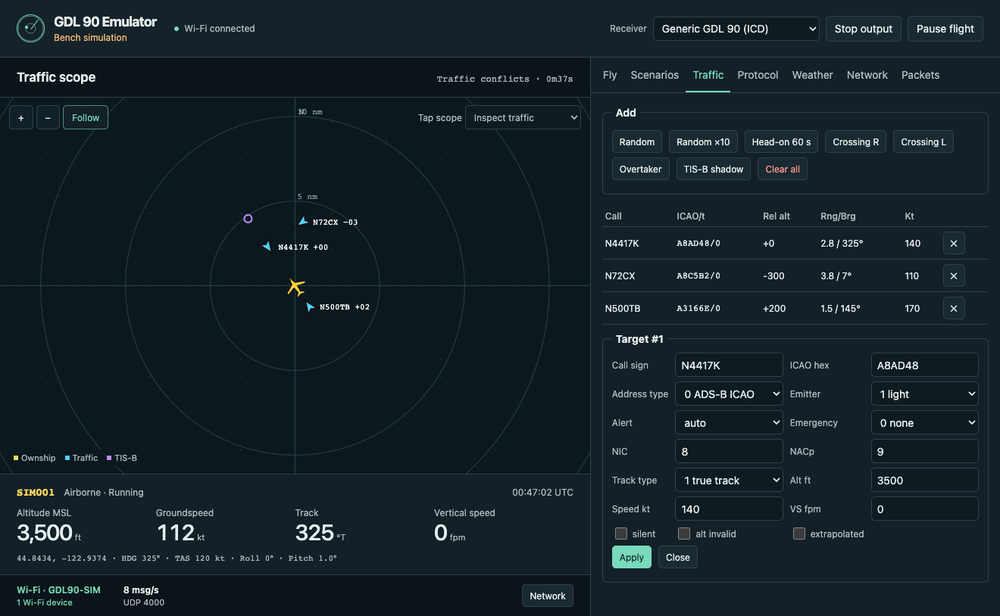

# GDL 90 Simulator for ESP32

Plug a classic ESP32 into a computer, open the browser panel, and fly a simulated aircraft with traffic and weather. Tablets join the board's own Wi-Fi to receive GDL 90 over UDP. The computer can stay on its normal network. Use the simulator on the ground with test devices. All positions, traffic and weather are simulated.



## Use a flashed board

1. Connect the ESP32 using a USB **data** cable.
2. Download **gdl90-usb-panel.html** from the [latest release](https://github.com/hemenway/gdl90-esp32/releases/latest). Open the downloaded file in desktop Chrome or Edge, click **Connect via USB**, and select the board's serial port. On a CP2102 board it may appear as *CP2102 USB to UART Bridge Controller* or *Silicon Labs*.
3. On a tablet, join **GDL90-SIM**. The default network is open. Choose to stay connected if the tablet reports that the network has no internet. Open your EFB and enable its GDL 90 or compatible Wi-Fi receiver input. The generic profile sends to UDP **4000**.
4. In the panel, open **Scenarios** and load **Traffic conflicts** to see three nearby aircraft. **Network** lists joined devices, delivery addresses, and send counts. **Packets** shows the messages the simulator generated.

You can also open the entire control panel on any device connected to GDL90-SIM at [192.168.4.1](http://192.168.4.1/). Wi-Fi control works with USB power from a wall charger or battery. The panel, radar and controls work offline. Opening the panel synchronizes the board's UTC clock for weather and heartbeat timestamps.

### Safari, Firefox and the USB launcher

Download and extract the release source ZIP. With Python 3 installed, double-click **Open USB Panel.command** on macOS or **Open USB Panel.cmd** on Windows. The launcher finds the board and opens the panel in your default browser. Leave the launcher running. Its first use installs pyserial in a per-user environment if necessary. On Linux or to select a specific port, use the launcher from a terminal.

```sh
python3 tools/usb_panel.py
python3 tools/usb_panel.py --port /dev/ttyUSB0
```

Use one USB controller at a time. Close serial monitors or the helper before connecting directly from Chrome or Edge. Wi-Fi clients can continue using the board while USB is connected.

## Flash a new board

The release image targets the **original dual-core ESP32 with at least 4 MB flash**. The tested board is an ESP32-D0WD-V3 revision 3.1 with a CP2102 USB-UART bridge. ESP32-S2, S3, C3 and other families require separate firmware builds.

1. Download **gdl90-esp32.bin** from the [latest release](https://github.com/hemenway/gdl90-esp32/releases/latest).
2. Open [Espressif's browser flasher](https://espressif.github.io/esptool-js/) in desktop Chrome or Edge. Connect to the board, choose the binary and enter **0x0** for the flash address. The file includes the bootloader, partition table and application. Writing it replaces firmware and saved simulator settings.
3. Program the image, disconnect the flasher, and press the board's **EN/RESET** button or reconnect the cable. Open the USB control panel.

Alternatively, with esptool 5 installed, replace `PORT` with your board's serial port.

```sh
esptool --port PORT flash-id
esptool --chip esp32 --port PORT --baud 460800 write-flash 0x0 gdl90-esp32.bin
```

If the board does not appear, try a known data cable and check the USB-UART driver. If a transfer is unreliable, use 115200 baud. On boards without automatic download mode, hold **BOOT** while connecting the flasher and release it once the chip is detected. [Espressif flashing guide](https://docs.espressif.com/projects/esp-idf/en/stable/esp32/get-started/flashing-troubleshooting.html)

## Controls and output

| Area | What you can do |
| --- | --- |
| Fly | Adjust altitude, track, speed, wind and simulation speed. Fly a route, orbit an anchor, teleport, pause motion or stop transmission. |
| Scenarios | Choose from 14 presets including taxi, traffic pattern, approach, cross-country, busy airspace and weather. Set the anchor and runway heading. |
| Traffic | Add, edit or remove targets and inspect their tracks, relative altitude, range, alerts and emergency status on the offline radar. The ESP32 supports up to 40 targets. |
| Protocol | Choose among 10 profiles, adjust message rates, receiver ID, GPS and AHRS, and set delivery preferences. Profiles include generic GDL 90, ForeFlight extensions, Stratux, X-Plane text and NMEA. |
| Weather | Edit METAR/TAF text and place NEXRAD cells to generate FIS-B uplinks. |
| Packets | Inspect recent decoded messages and hex bytes along with lengths, counts and rates. |
| Network | Inspect associated clients, set the SSID, WPA2 password and channel, or toggle the captive portal. |

**Pause** freezes flight motion while reports continue. **Stop** stops simulator output. Loading a scenario selects its initial receiver profile and begins the flight. To use another profile, apply it after loading the scenario.

By default the board sends unicast to clients it discovers on its own 192.168.4.0/24 network. Until it discovers a client, it uses the AP subnet broadcast. Automatic discovery also listens for ForeFlight on UDP 63093 and receiver probes on 41500. Devices receive data on the port selected by the profile or advertised through discovery. The ForeFlight extensions and discovery format are documented in the [ForeFlight GDL 90 specification](https://www.foreflight.com/connect/spec/).

To keep protocol, flight, weather and access-point settings through a power cycle, select **Save current setup as power-on default** in **Protocol**. Live traffic, packet history and elapsed scenario time start fresh on boot. For Wi-Fi changes, apply them in **Network** and reconnect to the new SSID. Joined devices can access the control panel. Set a WPA2 password if the bench is in a shared space.

## Build from source

The released firmware uses ESP-IDF v5.3.2, the esp-rs Xtensa Rust toolchain 1.97.0.0 and espflash 4.7.0. Install rustup, Git, CMake, Ninja and Python 3 (the release build used Python 3.12). Use a build directory whose path contains no spaces. Install the Rust tools and run the shared protocol and flight-model tests from the repository root.

```sh
cargo test --locked
cargo install --locked espup ldproxy
cargo install --locked --version 4.7.0 espflash
espup install --toolchain-version 1.97.0.0 --targets esp32 --std
. "$HOME/export-esp.sh"       # macOS and Linux
cd esp32
cargo build --release --locked
```

To flash your locally built application, use the command below from `esp32/`. Substitute your device port. The initial ESP-IDF build downloads its SDK and tools. If your checkout path has spaces, set `CARGO_TARGET_DIR` to a short directory without spaces and use that directory in the flash command.

```sh
espflash flash --port PORT --chip esp32 \
  --bootloader target/xtensa-esp32-espidf/release/bootloader.bin \
  --partition-table partitions.csv target/xtensa-esp32-espidf/release/gdl90-esp32
```

Regenerate the standalone USB panel from the repo root with `python3 tools/build_usb_page.py gdl90-usb-panel.html`. The Wi-Fi panel is embedded into the firmware at compile time. Both browser panels use the same flight controls.

The optional Rust desktop simulator shares the engine and protocol implementation. Run `cargo run --release -- --help` for its CLI. `cargo run --release -- listen --port 4000 --seconds 10` on a computer joined to the board's Wi-Fi acts as a receiver and decodes the stream. Desktop recording and replay use the iFly ADS-B recording container. Replay emits supported, checksum-valid standard messages. The ESP32 keeps a bounded live log in RAM.

Shared code lives in `src/`, firmware in `esp32/`, browser controls in `ui/`, and the USB launcher and panel builder in `tools/`. The GDL 90 framing and FIS-B tests include the published Garmin data-interface examples. [espup installation](https://github.com/esp-rs/espup) · [espflash](https://github.com/esp-rs/espflash)
